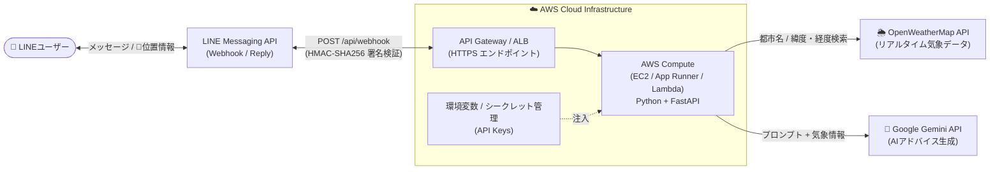

# 🌤️ AIお天気LINEボット (Python / FastAPI × AWS構成)

日常の「今日って傘いる？」「どんな服を着ていけばいい？」という悩みを解決する、**AIアシスタント機能付きのお天気LINEボット**です。

LINEトーク画面から「都市名」や「現在地（GPS位置情報）」を送信すると、リアルタイムの気象データを取得し、AIキャラクター（オカン・ツンデレ・執事・ギャル）が具体的な**服装と傘のアドバイス**を返信します。

---

## 🏗️ 1. システムアーキテクチャ (AWS インフラ構成)

個人開発における**運用コストの最小化**と**可用性・スケーラビリティ**を両立するため、データベースを持たない**完全ステートレス（DBレス）なバックエンド構成**として設計しています。



---

## 🛠️ 2. 技術スタック

| レイヤー | 技術要素 | 選定理由・役割 |
| :--- | :--- | :--- |
| **インフラ (Cloud)** | **AWS** (EC2 / App Runner / Lambda) | HTTPS Webhookの受け皿およびPythonアプリケーションのホスティング環境として採用 |
| **バックエンド** | **Python 3 / FastAPI / Uvicorn** | 軽量・高速でヘルスチェック (`GET /`) やWebhook処理をシンプルに実装できるため |
| **外部API連携** | **LINE Messaging API**<br>**OpenWeatherMap API**<br>**Google Gemini API** | LINE送受信、都市名・GPS座標からの気象取得、キャラクター口調のAIアドバイス生成 |

---

## 💡 3. インフラ・設計上の工夫（アピールポイント）

1. **クラウド運用に適したステートレス（DBレス）設計**
   - LINEの「位置情報メッセージ（GPS緯度・経度）」やテキスト内の都市名からその場で気象データを取得する設計にすることで、RDS等のデータベースを不要にしました。
   - ステート（状態）を持たないため、コンテナの再起動やスケールアウトに強く、インフラ維持コストを最小限に抑えています。
2. **外部API障害時にもサービスを止めないフォールバック機構**
   - Gemini APIのレート制限や通信タイムアウトが発生した場合でも、Python側の条件分岐によるルールベース応答へ自動的に切り替わり、常に200 OKと服装アドバイスを返却できる可用性を確保しています。
3. **セキュリティとヘルスチェックの実装**
   - **署名検証**: `X-Line-Signature` ヘッダーを `HMAC-SHA256` で検証し、LINEプラットフォーム以外からの不正リクエストを遮断します。
   - **ヘルスチェック**: AWSのロードバランサーやApp Runnerからの死活監視に対応する `GET /` エンドポイントを実装しています。

---

## 📂 4. ファイル構成

シンプルで保守しやすい単一ファイル構成です。

```text
weatherbot/
├── main.py            # FastAPI アプリケーション本体（Webhook・気象取得・AI連携）
├── requirements.txt   # Python 依存ライブラリ一覧
└── README.md          # プロジェクトドキュメント
```

---

## 🚀 5. ローカル起動・デプロイ手順

### 1. パッケージのインストール

```bash
pip install -r requirements.txt
```

### 2. 環境変数の設定

`.env` ファイル（またはAWSの環境変数設定）に以下のキーを設定します。

```env
LINE_CHANNEL_ACCESS_TOKEN=your_line_channel_access_token
LINE_CHANNEL_SECRET=your_line_channel_secret
OPENWEATHER_API_KEY=your_openweather_api_key
GEMINI_API_KEY=your_gemini_api_key
```

### 3. サーバー起動

```bash
uvicorn main:app --host 0.0.0.0 --port 8000
```

- **ヘルスチェック確認**: `http://localhost:8000/`
- **LINE Webhook URL**: `https://<AWSエンドポイント>/api/webhook`
